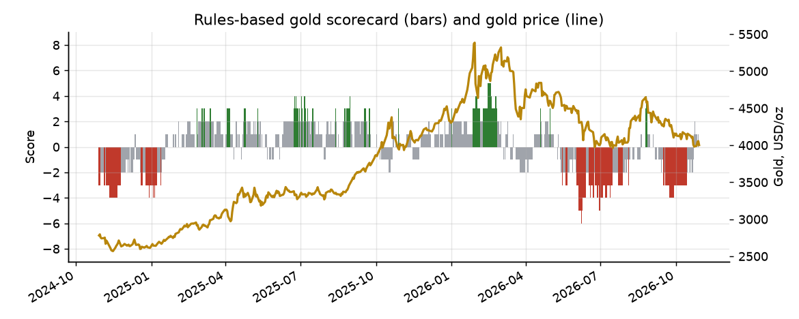

# Gold & Macro Monitor

A daily, fully automated dashboard that puts gold in its macro context: a transparent rules-based scorecard for gold, US rates and inflation, the dollar and major currencies, a commodity cross-section, futures positioning and on-chain demand for tokenized gold. Everything comes from free public data and is rebuilt every day by GitHub Actions.

> 中文简介：每天自动更新的黄金宏观看板。先给出基于 9 项因子的黄金综合判断（实际利率、美元、美联储政策预期、通胀预期、风险偏好、价格趋势、超买超卖、期货持仓、链上黄金需求），再分板块展示宏观利率、美元与外汇、大宗商品、CFTC 持仓和代币化黄金（XAU₮、PAXG 等）。页面支持中英文切换，全部使用公开数据。

**Live dashboard:** https://mliu86574-png.github.io/tokenized-gold-tracker/

## Latest reading

<!-- SNAPSHOT:START -->
**Gold scorecard: Neutral (+1 from 8 factors).** Gold last 4,055.98 USD/oz, -1.16% over one month.



| Factor | Signal |
|---|---|
| US real yields | ▲ supportive |
| US dollar | ▼ headwind |
| Fed policy expectations | ▲ supportive |
| Inflation expectations | ● neutral |
| Risk appetite | n/a |
| Price trend | ▼ headwind |
| Short-term stretch | ● neutral |
| Futures positioning | ● neutral |
| Tokenized gold demand | ▲ supportive |

| Token | Market cap | Share | Price (USD) | 24h volume | 30d price change |
|---|---:|---:|---:|---:|---:|
| XAUT (Tether Gold) | $3.26bn | 59.4% | 4,030.73 | $222.38m | -2.40% |
| PAXG (PAX Gold) | $1.80bn | 32.8% | 4,037.27 | $96.31m | -2.40% |
| KAU (Kinesis Gold) | $356.25m | 6.5% | 130.08 | $0.04m | -1.78% |
| XAUm (Matrixdock Gold) | $70.10m | 1.3% | 4,038.24 | $0.60m | -2.08% |

_Last updated 2026-10-29 03:41 (UTC). Source: CoinGecko, DefiLlama._
<!-- SNAPSHOT:END -->

## What the page shows

| Section | Contents | Source |
|---|---|---|
| Gold view | Composite score, stance, factor-by-factor readings, auto-generated summary, next FOMC decision | Derived |
| Gold market | Price with 50/200-day averages, 52-week range, RSI, realised volatility, gold priced in EUR, GBP, JPY, CNY and HKD | Yahoo Finance, fallback GLD rescaled to the XAU₮ per-ounce price |
| Macro & rates | Nominal and real 10Y yields, 2Y, breakevens, curve, Fed funds, SOFR, CPI, core CPI, core PCE, unemployment, payrolls, Fed balance sheet, VIX, high-yield spread | US Treasury, NY Fed, Cboe, BLS first; FRED for the rest |
| US dollar & FX | DXY, Fed broad dollar index, EUR, JPY, GBP, AUD, CHF, CNY, HKD against the dollar, trend labels | Yahoo Finance, fallback ECB reference rates (DXY rebuilt with the ICE formula), FRED |
| Commodities | Precious and base metals, energy, grains and the S&P GSCI: returns, trend, RSI, volatility; gold/silver, copper/gold and gold/oil ratios | Yahoo Finance, fallback ETF proxies via Nasdaq (marked on the page, excluded from ratios) / FRED |
| Positioning | Managed-money net positions in gold, silver and copper futures, with 3-year percentiles | CFTC Commitments of Traders |
| Tokenized gold | Market cap, share and price per token; ounces outstanding; XAU₮–PAXG spread; chain distribution; league table of every gold token on CoinGecko (unit, tonnes, price vs median token); net issuance (mint minus redeem) over 7 and 30 days; trading venues, on-chain share, spreads and ±2% depth; DeFi pools holding gold tokens (TVL, APY, LTV); volatility, correlation and tracking error vs gold | CoinGecko, DefiLlama |

## The scorecard

Each factor scores +1 when it is in a state that has historically supported gold, −1 when it is a headwind and 0 otherwise. A total of +3 or more reads as **constructive**, −3 or less as **cautious**, anything in between as **neutral**. Factors without data are left out rather than guessed.

| Factor | Rule |
|---|---|
| US real yields | 10Y TIPS yield, 30-day change: ≤ −10 bp supportive, ≥ +10 bp headwind |
| US dollar | Fed broad dollar index, 30-day change: ≤ −1% supportive, ≥ +1% headwind |
| Fed policy expectations | 2Y Treasury yield, 30-day change: ≤ −15 bp supportive, ≥ +15 bp headwind |
| Inflation expectations | 10Y breakeven, 30-day change: ≥ +10 bp supportive, ≤ −10 bp headwind |
| Risk appetite | High-yield spread widening ≥ 40 bp in 30 days or VIX ≥ 25 supportive; tightening ≥ 40 bp with VIX ≤ 15 headwind |
| Price trend | Above both 50- and 200-day averages supportive; below both headwind |
| Short-term stretch | 14-day RSI ≤ 30 supportive; ≥ 70 headwind |
| Futures positioning | Managed-money net long as % of open interest vs its 3-year range: ≤ 20th percentile supportive, ≥ 80th headwind |
| Tokenized gold demand | XAU₮ + PAXG ounces outstanding (market cap ÷ price), 30-day change: ≥ +2% supportive, ≤ −2% headwind |

The rules are deliberately simple so that every reading can be checked by hand. The score is a summary of conditions, not a forecast. The dashboard also charts the score's daily history against the gold price.

Optional: write your own view in [`notes.md`](notes.md). If the file has content, it appears on the page as "Author's notes", clearly separated from the rules-based score.

## How it works

```
GitHub Actions (daily 01:17 UTC)
  └─ python -m goldtrack.build
       ├─ fetch.py      CoinGecko + DefiLlama (tokenized gold)
       ├─ sources.py    Yahoo Finance chart API, FRED (API or CSV), CFTC Socrata API
       ├─ tokens.py     tokenized-gold league table, issuance, venues, DeFi, risk
       ├─ official.py   fallbacks: Treasury, NY Fed, Cboe, BLS, ECB, ETF proxies
       ├─ transform.py  token tables: snapshot, history, spread, chain split
       ├─ macro.py      performance, technicals, FX conventions, ratios, positioning, scorecard
       ├─ narrative.py  English and Chinese commentary filled from the numbers
       ├─ dashboard.py  docs/index.html (interactive ECharts, EN/中文 toggle)
       └─ report.py     README summary
  └─ commit data/, docs/, README.md
GitHub Pages serves docs/
```

Each source is optional. If a feed fails, the build records it in `data/status.json`, shows it under "Data status" on the page and carries on with the rest. The tests (`tests/`) run offline on synthetic data that mimics each API's format, including outage cases and the scorecard rules.

Raw and derived data are committed daily: `data/markets.csv`, `data/macro.csv`, `data/cot_*.csv`, `data/scorecard.json`, plus the token files.

## Run it yourself

```bash
pip install -e ".[dev]"
pytest
python -m goldtrack.build      # writes docs/index.html
```

Instruments, FRED series, COT markets and FOMC dates live in [`config.json`](config.json) and can be changed without touching code.

## Data notes

- Futures are continuous front-month contracts from Yahoo Finance; contract rolls can cause small jumps.
- FX changes are shown as each currency's move against the US dollar, so a positive number always means the currency strengthened.
- Yahoo Finance and the FRED graph CSV often refuse requests from cloud CI runners, so each series falls back to the agency that publishes it; `data/status.json` records which source was used. Adding a free FRED API key as the repository secret `FRED_API_KEY` restores the series that only FRED carries (core PCE, high-yield spread, Fed balance sheet, broad dollar index).
- FRED series are published with a lag of one day (markets) to several weeks (monthly releases); the as-of date is shown next to every figure.
- KAU is priced per gram, so its unit price is not comparable with the per-ounce tokens; market cap and share are.
- For information only. Not investment advice.

## License

MIT
